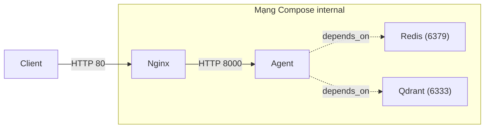

# Day 14 Lab - Mission Answers

## Part 1: Localhost vs Production

### Exercise 1.1: Anti-patterns found

Các số dòng dưới đây trỏ đến `01-localhost-vs-production/develop/app.py`.

1. **Thông tin xác thực ghi cứng (dòng 17–18).** API key và chuỗi kết nối nằm trong mã nguồn. Nếu dùng thông tin thật, chúng có thể bị lộ qua bản sao repo hoặc lịch sử Git.
2. **In dữ liệu nhạy cảm ra log (dòng 33–38).** `print()` ghi cả key, câu hỏi và câu trả lời. Dữ liệu có thể bị lưu vào hệ thống thu thập log. Các dòng này cũng thiếu cấu trúc thống nhất để lọc sự kiện.
3. **Thiếu endpoint kiểm tra sức khỏe (dòng 25–31, 42–43).** App chỉ định nghĩa `/` và `/ask`. Nền tảng thiếu tín hiệu riêng để biết tiến trình còn hoạt động và khi nào nên chuyển request vào.
4. **Chỉ bind vào `localhost` (dòng 51).** Trong container, địa chỉ loopback chỉ nhận kết nối từ chính container, nên proxy hoặc cổng được publish khó tiếp cận app qua mạng container.
5. **Port cố định `8000` (dòng 52).** App bỏ qua `PORT` của môi trường. Nếu nền tảng cấp port khác, lưu lượng có thể được chuyển đến cổng mà app chưa mở.
6. **Luôn bật tự động nạp lại (dòng 53).** `reload=True` theo dõi thay đổi mã nguồn và có thể khởi động lại tiến trình khi file thay đổi. Cơ chế này phù hợp lúc lập trình và gây gián đoạn nếu dùng khi phục vụ lưu lượng thật.
7. **Thiếu bước dọn tài nguyên của ứng dụng khi tắt (dòng 13).** App tạo `FastAPI` mà chưa đăng ký `lifespan`. Khi thêm kết nối hoặc dữ liệu cần ghi, app cần một điểm dọn dẹp rõ ràng trong quá trình shutdown.

### Exercise 1.2: Develop version test

```bash
curl -i -X POST 'http://localhost:8000/ask?question=Hello'
```

```http
HTTP/1.1 200 OK
date: Wed, 25 Nov 2026 07:39:58 GMT
server: uvicorn
content-length: 126
content-type: application/json

{"answer":"Đây là câu trả lời từ AI agent (mock). Trong production, đây sẽ là response từ OpenAI/Anthropic."}
```

#### Quan sát

Bản develop trả `200 OK` trên máy local và chưa sẵn sàng cho production. API key và cổng còn ghi cứng, tự động nạp lại luôn bật và app thiếu endpoint kiểm tra sức khỏe.

### Exercise 1.3: Comparison table

| Feature | Develop | Production | Why Important? |
|---------|---------|------------|----------------|
| Config | Ghi cứng API key và cổng trong `develop/app.py` dòng 17 và 52. | Đọc `PORT` và key từ biến môi trường trong `production/config.py` dòng 18 và 27. `production/app.py` dòng 197 dùng cổng từ cấu hình. | Đổi cấu hình theo môi trường và giữ secret ngoài mã nguồn. |
| Health check | Thiếu endpoint kiểm tra sức khỏe. | `GET /health` báo tiến trình còn hoạt động. `GET /ready` báo app đã sẵn sàng nhận request. | Nền tảng có thể phát hiện lỗi và điều phối lưu lượng đến instance sẵn sàng. |
| Logging | Dùng `print()` và in cả API key. | Dùng `logging`, tạo sự kiện có cấu trúc và khai báo định dạng JSON. | Log có cấu trúc dễ tìm kiếm và phân tích. Giữ key ngoài log giúp tránh lộ secret. |
| Shutdown | Dùng vòng đời mặc định của FastAPI. | Dùng `lifespan` để thực hiện bước dọn dẹp khi tắt, cùng quy trình graceful shutdown của Uvicorn. | Cho request đang chạy thời gian hoàn tất và cho app cơ hội giải phóng tài nguyên. |

Ví dụ, `develop/app.py` dòng 53 luôn bật tự động nạp lại với `reload=True`. `production/app.py` dòng 198 dùng `reload=settings.debug`, nên chỉ bật khi đặt `DEBUG=true`. Giá trị mặc định là `false` tại `production/config.py` dòng 19.

## Part 2: Docker

### Exercise 2.1: Dockerfile cơ bản

1. **Base image là gì?** `python:3.11`.
2. **Working directory là gì?** `/app` trong container.
3. **Tại sao copy `requirements.txt` trước?** Docker có thể dùng lại layer `pip install` khi chỉ sửa code. Khi `requirements.txt` thay đổi, layer cài thư viện sẽ được build lại.
4. **`CMD` và `ENTRYPOINT` khác nhau thế nào?** `CMD` đặt lệnh hoặc đối số mặc định, có thể ghi đè bằng đối số sau tên image trong `docker run`. `ENTRYPOINT` đặt chương trình chính. Khi kết hợp cả hai ở dạng exec, `CMD` cung cấp các đối số mặc định cho `ENTRYPOINT`.

### Exercise 2.2: Build và run

Bản develop nhận `question` qua query string theo lưu ý K5.

```bash
docker build -f 02-docker/develop/Dockerfile -t my-agent:develop .
docker run --rm -d --name day14-cp2-develop -p 8000:8000 my-agent:develop
curl -i -X POST 'http://localhost:8000/ask?question=What%20is%20Docker%3F'
```

```http
HTTP/1.1 200 OK

{"answer":"Container là cách đóng gói app để chạy ở mọi nơi. Build once, run anywhere!"}
```

#### Quan sát

Trong output `docker images my-agent`, image `my-agent:develop` có `DISK USAGE` là **1,67 GB**.

### Exercise 2.3: Multi-stage build

1. **Stage 1 làm gì?** `builder` cài công cụ build (`gcc`, `libpq-dev`) và thư viện Python vào `/root/.local`.
2. **Stage 2 làm gì?** `runtime` dùng `python:3.11-slim`, sao chép thư viện đã cài và mã ứng dụng, rồi chạy Uvicorn dưới user `appuser`.
3. **Tại sao image nhỏ hơn?** Base `slim` nhỏ hơn `python:3.11`, còn công cụ build chỉ nằm trong stage `builder`.

```bash
docker build -f 02-docker/production/Dockerfile -t my-agent:advanced .
docker images my-agent
```

- **Develop** hiển thị `1,67 GB`, tương đương **1.667,77 MB** theo số byte từ `docker image inspect`.
- **Production** hiển thị `240 MB`, tương đương **239,82 MB** theo số byte từ `docker image inspect`.
- **Chênh lệch** giảm **85,62%** so với bản develop.

### Exercise 2.4: Docker Compose stack

```bash
cd 02-docker/production
touch .env.local
docker compose -p k5-day14-docker pull --ignore-buildable
docker tag my-agent:advanced k5-day14-docker-agent
docker compose -p k5-day14-docker up --no-build --pull never --wait
docker compose -p k5-day14-docker ps
```



Compose chờ Redis và Qdrant qua health check trước khi khởi động Agent. Nginx chuyển request đến `agent:8000` qua mạng nội bộ. `docker compose ps` ghi nhận cả bốn service đã chạy, với Agent, Redis và Qdrant ở trạng thái `healthy`.

```bash
curl -i http://localhost/health
```

```http
HTTP/1.1 200 OK
Server: nginx

{"status":"ok","uptime_seconds":4.4,"version":"2.0.0","timestamp":"2026-11-25T08:00:15.813749"}
```

```bash
curl -i -X POST http://localhost/ask \
  -H 'Content-Type: application/json' \
  -d '{"question":"Explain microservices"}'
```

```http
HTTP/1.1 200 OK
Server: nginx

{"answer":"Agent đang hoạt động tốt! (mock response) Hỏi thêm câu hỏi đi nhé."}
```

## Part 3: Cloud Deployment

### Exercise 3.1: Railway deployment

Đã triển khai agent Part 6 và Redis trong môi trường `production` của project `day14-cp6`. URL public là [agent-production-ef571d64.up.railway.app](https://agent-production-ef571d64.up.railway.app). `/health` và `/ready` trả `200`. `POST /ask` trả `401` khi thiếu key và `200` với key hợp lệ. Xem các lệnh kiểm tra trong [DEPLOYMENT.md](DEPLOYMENT.md).

### Exercise 3.2: So sánh Railway và Render

| Điểm so sánh | Railway (`railway.toml`) | Render (`render.yaml` mẫu) |
| --- | --- | --- |
| Phạm vi cấu hình | `[build]` chọn `DOCKERFILE` và `[deploy]` đặt `/health` cho service agent. Redis và biến môi trường được thêm trong project. | Blueprint YAML khai báo nhiều tài nguyên trong `services`, gồm web service và Redis. Web service mẫu khai báo lệnh build, start và health check `/health`. |
| Secret | `AGENT_API_KEY` và kết nối Redis được cấu hình bằng biến môi trường trên Railway. | `envVars` cho phép sinh khóa bằng `generateValue: true` hoặc nhập ở dashboard khi dùng `sync: false`. |

Railway dùng cấu hình gọn cho từng service. Blueprint của Render mô tả cả tài nguyên và cấu hình của chúng trong một file.

### Exercise 3.3: Cloud Run

1. `cloudbuild.yaml` cài dependencies và chạy `pytest` trước bước build.
2. Bước `build` chờ bước `test` qua `waitFor`, build image Docker và gắn tag `$COMMIT_SHA` và `latest`. Bước `push` đưa cả hai tag lên registry.
3. Sau khi push, pipeline deploy image theo `$COMMIT_SHA` lên Cloud Run tại `asia-southeast1`, đặt cấu hình tài nguyên, biến môi trường và tham chiếu secret.
4. `service.yaml` mô tả service như mã, gồm scale 1–10 instance, cổng `8000`, probe `/health` và `/ready`, cùng các tham chiếu đến Secret Manager.

## Part 4: API Security

### Exercise 4.1: API Key authentication

1. `verify_api_key()` trong `04-api-gateway/develop/app.py` dòng 39 đọc `X-API-Key` và so sánh với `AGENT_API_KEY`. `POST /ask` gắn dependency này ở dòng 70.
2. Thiếu key trả `401`. Sai key trả `403`.
3. Để xoay key, cập nhật `AGENT_API_KEY`, khởi động lại app để nạp giá trị mới và cập nhật header của client.

**Thiếu key**

```http
HTTP/1.1 401 Unauthorized

{"detail":"Missing API key. Include header: X-API-Key: <your-key>"}
```

**Sai key**

```http
HTTP/1.1 403 Forbidden

{"detail":"Invalid API key."}
```

**Đúng key**

```http
HTTP/1.1 200 OK

{"question":"Hello","answer":"Agent đang hoạt động tốt! (mock response) Hỏi thêm câu hỏi đi nhé."}
```

### Exercise 4.2: JWT authentication

Gửi thông tin đăng nhập của tài khoản demo `student` đến `POST /auth/token`. Server xác thực tài khoản, ký JWT chứa định danh, vai trò và thời điểm hết hạn. Client gửi token qua `Authorization: Bearer $TOKEN` khi gọi `POST /ask`. Server kiểm tra chữ ký và hạn dùng trước khi xử lý request.

**`POST /auth/token`**

```http
HTTP/1.1 200 OK

{"access_token":"[REDACTED]","token_type":"bearer","expires_in_minutes":60}
```

**`POST /ask` với Bearer token**

```http
HTTP/1.1 200 OK

{"question":"Explain JWT","answer":"Agent đang hoạt động tốt! (mock response) Hỏi thêm câu hỏi đi nhé.","usage":{"requests_remaining":9,"budget_remaining_usd":1.6e-05}}
```

### Exercise 4.3: Rate limiting

1. **Thuật toán** dùng sliding window. `rate_limiter.py` lưu timestamp theo người dùng, loại các mốc ngoài cửa sổ 60 giây và đếm số mốc còn lại.
2. **Giới hạn** là 10 request trong 60 giây cho `student`.
3. **Quyền admin** được server xác định từ JWT đã xác thực. App chọn limiter riêng với 100 request trong 60 giây cho vai trò `admin`.

Vòng lặp 20 request có **9 phản hồi `200`** và **11 phản hồi `429`**. Request `/ask` của 4.2 đã dùng một lượt, nên lần gọi thứ 10 trong vòng lặp là lần gọi `/ask` thứ 11 của `student` trong cửa sổ này.

```http
HTTP/1.1 429 Too Many Requests
x-ratelimit-limit: 10
x-ratelimit-remaining: 0
retry-after: 59

{"detail":{"error":"Rate limit exceeded","limit":10,"window_seconds":60,"retry_after_seconds":59}}
```

### Exercise 4.4: Cost guard

Với ngân sách **10 USD/người dùng/tháng**, lưu chi phí theo khóa Redis `budget:{user_id}:{YYYY-MM}`. Trước khi gọi LLM, kiểm tra và giữ chỗ cho chi phí ước tính trong một thao tác nguyên tử để các request đồng thời dùng chung hạn mức. Trả `402` nếu tổng dự kiến vượt ngân sách. Sau khi gọi LLM, đối soát phần đã giữ với chi phí thực tế tính từ token đầu vào và đầu ra. Sang tháng mới, dùng khóa kỳ mới với ngân sách đầy đủ.

Rate limit kiểm soát số request trong một khoảng thời gian. Cost guard kiểm soát tổng tiền, kể cả khi từng request dùng nhiều token nhưng vẫn nằm trong giới hạn tần suất.

## Part 5: Scaling & Reliability

### Exercise 5.1: Health checks

| Điều kiện kiểm thử | `GET /health` | `GET /ready` |
| --- | --- | --- |
| Startup hoàn tất | `200 OK`, `status: ok` | `200 OK`, `ready: true` |
| Mô phỏng app chưa sẵn sàng bằng `--lifespan off` | `200 OK`, `status: ok` | `503 Service Unavailable`, `Agent not ready. Check back in a few seconds.` |

Liveness cho biết tiến trình còn hoạt động để nền tảng quyết định có cần khởi động lại. Readiness cho biết instance đã sẵn sàng nhận request để bộ cân bằng tải quyết định có chuyển lưu lượng vào.

### Exercise 5.2: Graceful shutdown

Gửi song song hai request `POST /ask?question=hello` đến bản develop ở cổng `8000`, rồi gửi `SIGTERM` cho tiến trình Uvicorn sau 0,5 giây. Cả hai request đều trả `200 OK` và tiến trình thoát với mã `0`.

```text
INFO:     Shutting down
INFO:     Waiting for connections to close. (CTRL+C to force quit)
INFO:     Waiting for application shutdown.
INFO:     Application shutdown complete.
```

Uvicorn chờ request đang xử lý hoàn tất trong thời hạn graceful shutdown. Sau đó, FastAPI chạy phần dọn dẹp trong `lifespan`.

### Exercise 5.3: Stateless design

Mỗi replica có RAM riêng. Nếu lịch sử chỉ được giữ trong RAM của replica đầu tiên, request sau tới replica khác sẽ mất ngữ cảnh. Bản production dùng `session_id` để đọc và ghi lịch sử trong Redis theo khóa `session:{session_id}`, với TTL mặc định 3.600 giây. Các replica trong Compose cùng dùng `REDIS_URL=redis://redis:6379/0`, nên bất kỳ replica nào cũng lấy được lịch sử của session.

### Exercise 5.4: Load balancing

Docker Hub trả `429` khi Compose resolve tag `python:3.11-slim`. Image Agent được build lại từ bản sao tạm của Dockerfile với digest đã xác minh của cùng base image, sau đó dùng cho stack ba replica.

```bash
docker compose -p k5-day14-scaling up -d --no-build --pull never --scale agent=3
docker compose -p k5-day14-scaling ps
```

Cả ba replica Agent đều `healthy`. Mười request `POST /chat` qua Nginx tại `http://localhost:8080` đều trả `200 OK`. Trường `served_by` cho thấy Nginx phân phối như sau.

| Instance | Số request |
| --- | ---: |
| `instance-6d0703` | 4 |
| `instance-049565` | 3 |
| `instance-c7e44e` | 3 |

### Exercise 5.5: Test stateless

Chạy `python test_stateless.py` trong `05-scaling-reliability/production/`.

```text
Total requests: 5
Instances used: {'instance-c7e44e', 'instance-049565', 'instance-6d0703'}
Total messages: 10
```

Năm lượt chat dùng chung một `session_id` và được phục vụ bởi cả ba replica. Lịch sử vẫn đủ năm câu hỏi và năm câu trả lời. `redis-cli EXISTS` trả `1` cho khóa session của bài thử, xác nhận lịch sử nằm trong Redis dùng chung.


## Part 6: Final Project

Kết quả chạy `python check_production_ready.py` trong `06-lab-complete/` với Docker.

```text
  📋 Checklist Deliverable
     ✅ Dockerfile (multi-stage, < 500 MB)
     ✅ docker-compose.yml (agent + redis)
     ✅ .dockerignore
     ✅ Health check endpoint (GET /health)
     ✅ Readiness endpoint (GET /ready)
     ✅ API Key authentication
     ✅ Rate limiting
     ✅ Cost guard
     ✅ Config từ environment variables
     ✅ Structured logging
     ✅ Graceful shutdown
     ✅ Public URL ready (Railway / Render config)
----------------------------------------------------------------
  Result: 12/12 tiêu chí đạt · 41/41 checks passed
  🎉 PASS 12/12 — PRODUCTION READY! Deploy nào!
================================================================
```

`/health` báo tiến trình còn hoạt động. `/ready` kiểm tra kết nối Redis và trả `503` khi Redis mất kết nối để bộ cân bằng tải ngừng chuyển request đến instance chưa sẵn sàng.

## AI log

- **CP1.** Nhờ Codex chạy thử `curl` cho bản develop, chép output và đối chiếu Exercise 1.1–1.3 với mã nguồn và tiêu chí chấm. Codex bổ sung phân tích anti-pattern và bảng so sánh có số dòng. Tôi tự chạy lại `curl` trên bản develop để lấy output cho Exercise 1.2 và kiểm tra `/health`, `/ready`, `/ask` trên bản production.
- **CP2.** Nhờ Codex thực hiện Exercise 2.1–2.4 và điền Part 2. Codex đọc Dockerfile và Compose, build hai image, đo kích thước bằng Docker và kiểm tra các endpoint bằng `curl` trên máy làm bài. Bảng kích thước và kết quả HTTP lấy từ các lệnh đã chạy.
- **CP3.** Nhờ Codex thực hiện Exercise 4.1–4.4. Codex đọc mã mẫu, kiểm thử API key và JWT bằng `curl` trên localhost, đối chiếu 20 mã HTTP của bài rate limit và ghi lại cách thiết kế cost guard. Báo cáo dùng output đã chạy và che JWT.
- **CP4.** Nhờ Codex thực hiện Exercise 5.1–5.5. Codex gọi `/health` và `/ready`, gửi SIGTERM trong lúc xử lý request, kiểm tra `served_by` qua Nginx và chạy `test_stateless.py`. Các mã HTTP, lượt phân phối và số tin nhắn lấy từ kết quả đã chạy.
- **CP5.** Nhờ Codex hoàn thiện bản khung Part 6. Codex triển khai API key, rate limit và ngân sách ngày trong Redis, health/readiness, log JSON, shutdown và cấu hình Docker/Compose/Railway. Codex chạy script chấm đầy đủ với Docker và chép checklist thực tế vào Part 6.
- **CP6.** Nhờ Codex thực hiện Part 3. Tôi xác nhận đăng nhập Railway CLI. Codex triển khai agent và Redis, cấu hình kết nối nội bộ, thực hiện bốn lệnh kiểm tra URL public và đối chiếu cấu hình Railway, Render và Cloud Run.
- **CP7.** Nhờ Codex thực hiện Exercise 7.1–7.3. Codex bổ sung histogram, chạy load test và eval trên localhost, sửa hai mục knowledge base theo kết quả baseline, kiểm tra quality gate lần cuối và điền báo cáo từ JSON thực tế.
- **CP8.** Nhờ Codex thực hiện Exercise 7.4–7.7. Codex chạy tải Locust, đọc dashboard Grafana, đối chiếu trace Jaeger với log JSON, kiểm thử rule bằng `promtool` và đo thời gian hai alert chuyển sang `firing`. Kết quả và ảnh được đối chiếu với dữ liệu chạy thực tế.
